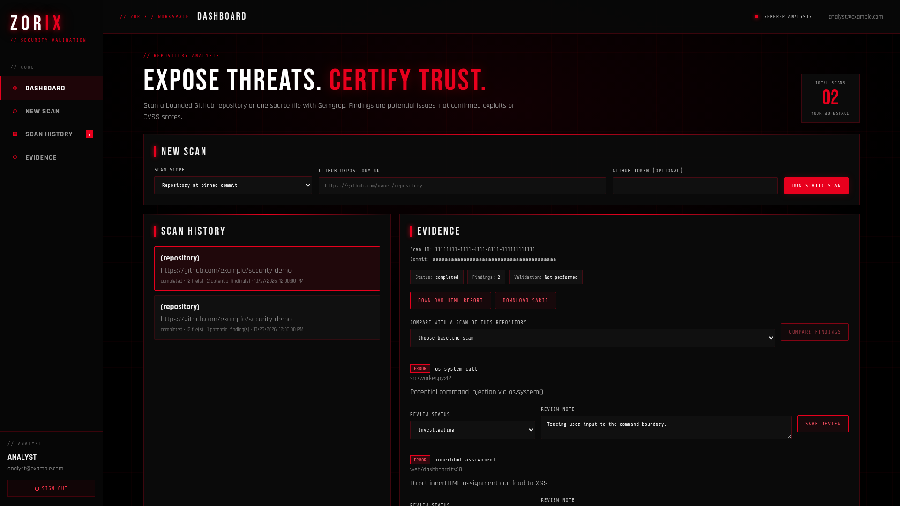
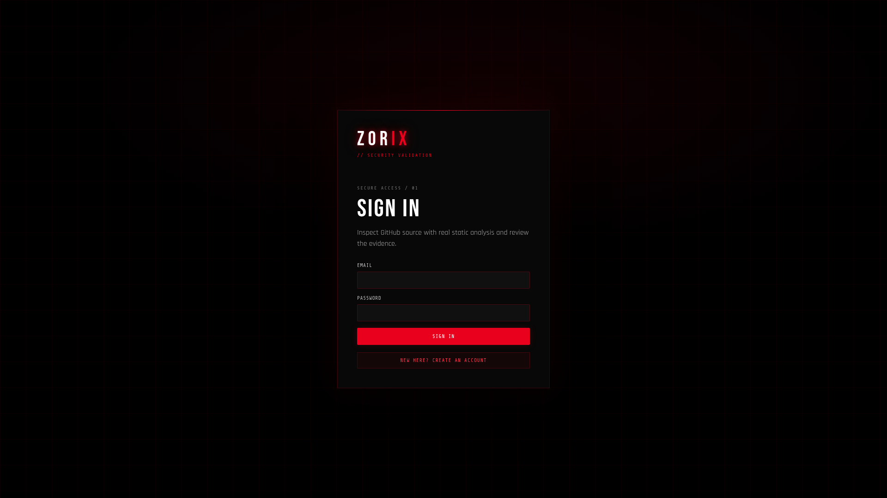
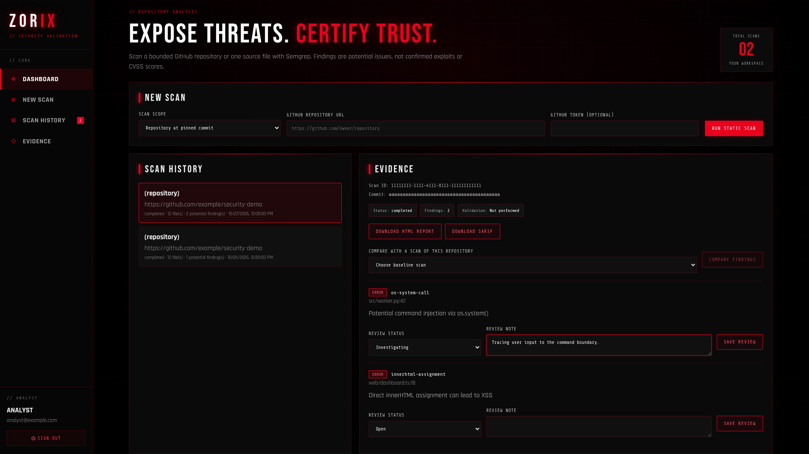
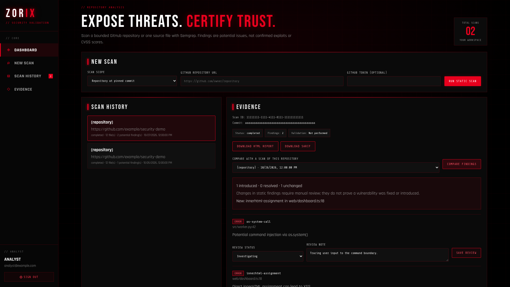
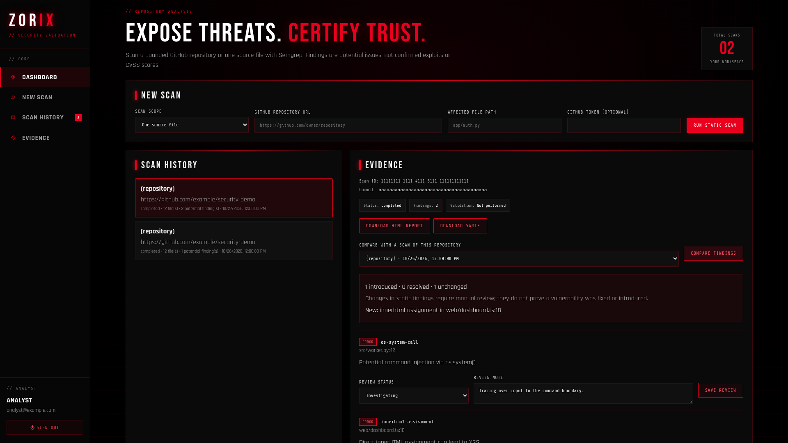
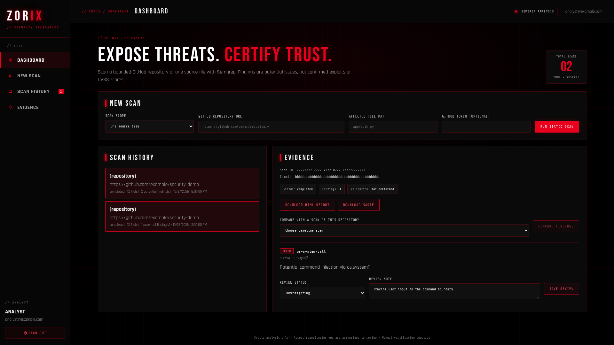
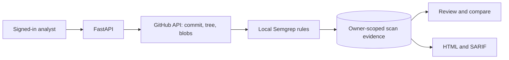

# Zorix

**A self-hosted workspace for reviewing GitHub source code with evidence you can check.** Give Zorix a repository URL, run a bounded Semgrep scan at a pinned commit, then inspect the findings, record review decisions, compare scans, and export HTML or SARIF.

[](https://github.com/rj-karan/Zorix-Exposing-Threats-Certifying-Trust/actions/workflows/ci.yml)

Zorix focuses on three things that matter in a security review:

- **Traceable input:** repository scans identify the commit and each selected blob; single-file scans also fetch at a resolved commit.
- **Evidence before verdicts:** Semgrep matches are potential issues for an analyst to review. Zorix does not invent exploit confirmation or CVSS scores.
- **Access enforced by the API:** scan history, review notes, comparisons, and downloads are scoped to the signed-in owner.



The screenshot uses **sample API responses** to show the interface. It is not a claim that the example repository has those findings. The capture script is in [`frontend/tools/capture-readme.mjs`](frontend/tools/capture-readme.mjs).

---

## Quick start

You need Docker with Compose v2. Clone this repository, then start the three services:

```bash
git clone https://github.com/rj-karan/Zorix-Exposing-Threats-Certifying-Trust.git
cd Zorix-Exposing-Threats-Certifying-Trust
docker compose up --build
```

The first build installs Python, Semgrep, and frontend dependencies and can take several minutes. Compose starts PostgreSQL, the API, and the React frontend. The application needs network access to the GitHub API when it scans.

| Open | What it is |
| --- | --- |
| <http://localhost:3000> | Zorix UI: register, sign in, scan, review, compare, export |
| <http://localhost:8000/docs> | FastAPI endpoint documentation |
| <http://localhost:8000/health> | API and Semgrep availability |

There are **no seeded users or canned findings**. Register your own account in the UI. For a small public scan, enter `https://github.com/pallets/itsdangerous` and choose **Repository at pinned commit**. A clean result means only that the bundled rules found no matches in the supported files; it does not certify the repository as secure. To scan a private repository or avoid public GitHub API rate limits, set `GITHUB_TOKEN` in the backend environment or enter a token for one scan. The per-scan token is not stored in the scan record.

If a host port is occupied, override it without changing container ports:

```bash
ZORIX_FRONTEND_PORT=13000 ZORIX_API_PORT=18000 docker compose up --build
```

Compose binds its host ports to `127.0.0.1`. Its default database password and API secret are for **local development only**; see [before deploying beyond localhost](#before-deploying-beyond-localhost).

---

## A five-minute tour

1. **Register and sign in.** The API issues a JWT and checks it on scan, result, review, comparison, and report routes.
2. **Choose a scope.** Scan up to 100 supported source files from a repository, or enter one relative file path. Each scan records the resolved commit SHA.
3. **Read the evidence.** A finding shows its rule, file, line, severity, and message. Scanner errors are reported as errors, not as clean scans.
4. **Triage a finding.** Set it to open, investigating, false positive, or accepted risk. The latter two require a written justification. Review status is an analyst decision, not exploit verification.
5. **Compare and export.** Compare completed scans of the same repository and scope to see static findings that appeared or disappeared. Download an HTML report or SARIF 2.1.0 artifact.

## Screenshots

These 1920 × 1080 wallpaper-size screenshots show the original Zorix red/black visual style on the working React interface, rendered with **illustrative sample scan data**. Generate them again with `npm run screenshots` in `frontend/` while the frontend dev server is running. The script uses system Chromium, or the executable set by `CHROMIUM_PATH`.

<table>
<tr>
<td width="50%"><br><b>Sign in.</b> Each analyst sees only their own scans and reviews.</td>
<td width="50%"><br><b>Scan workspace.</b> A bounded repository scan, history, commit ID, and finding evidence.</td>
</tr>
<tr>
<td><br><b>Review evidence.</b> Rule, location, message, analyst status, and note.</td>
<td><br><b>Compare scans.</b> Introduced, resolved, and unchanged static findings.</td>
</tr>
<tr>
<td><br><b>Single-file mode.</b> A relative file path and optional GitHub token.</td>
<td><br><b>Historical scan.</b> Select an earlier pinned scan and inspect its evidence.</td>
</tr>
</table>

---

## What's built, with proof

"Proof" names a test or check in this repository. The screenshot fixture is for presentation; the checks use the real application code and scanner.

| Capability | Where | Proof |
| --- | --- | --- |
| GitHub target validation | HTTPS `github.com` repository URLs and safe relative paths only | `test_target_validation_rejects_arbitrary_hosts_and_traversal` |
| Commit-pinned repository scan | Git tree and blob SHAs; rejects truncated trees and limit violations | `test_repository_snapshot_is_commit_pinned_and_rejects_incomplete_trees` |
| Commit-pinned file scan | Contents request uses the resolved commit as its `ref` | `test_single_file_fetch_uses_pinned_commit` |
| Actual static analysis | Local Semgrep rules for Python, JavaScript, and TypeScript | `test_semgrep_reports_real_rule_and_clean_file`, `test_repository_semgrep_preserves_relative_paths` |
| Private results and reports | Owner checks in the API, including SARIF and reviews | `test_authentication_and_scan_ownership` |
| Finding triage and scan comparison | Stored review status and note; same-scope comparison | `test_authentication_and_scan_ownership`, `test_scan_comparison_tracks_duplicate_findings_and_failed_scans` |
| CI and container hardening | Tests, dependency audits, Trivy secret/configuration gate, image builds; non-root app containers | [GitHub Actions](https://github.com/rj-karan/Zorix-Exposing-Threats-Certifying-Trust/actions/workflows/ci.yml) and a local Docker smoke test |

The backend tests exercise ownership and report escaping through FastAPI with a real test database. The frontend tests cover sign-in, scan submission, evidence, review controls, and comparison. The current local suite has **13 backend tests and 4 frontend tests**.

## How a scan works



Repository scans accept up to **100 supported files**, **200 KB per file**, and **2 MB total**. Supported extensions are `.py`, `.js`, `.jsx`, `.ts`, and `.tsx`. Generated and dependency directories are excluded. If the GitHub tree is truncated or a limit is exceeded, the scan fails explicitly; it does not report partial coverage as a complete result. The API runs at most two scans at once per process and returns 429 when both slots are busy.

Semgrep results retain the rule ID, file, line, severity, and message. A match is not proof of reachability or exploitability. A scan with zero matches does not prove the code is secure. Read [project scope and portfolio evidence](docs/PROJECT_SCOPE.md) for a role-by-role view of what this project demonstrates.

## Security, briefly

- GitHub URLs and paths are checked before fetching. Repository scans fetch specific blob SHAs rather than following a moving branch during the scan.
- Results, HTML reports, SARIF downloads, finding reviews, and comparisons all require authentication and owner checks. HTML report text is escaped.
- Per-scan GitHub tokens and fetched source contents are not stored in scan records. Semgrep metrics and version checks are disabled.
- The API and frontend containers run as non-root users. Compose does not mount the Docker socket, and its ports bind to localhost by default.
- CI runs `pip-audit`, `npm audit`, Trivy high/critical secret and configuration checks, tests, and Docker builds. Two scanner dependency exceptions are recorded in [SECURITY.md](SECURITY.md).

There is no exploit executor in the active application. Zorix reports no confirmed vulnerabilities and no CVSS score.

---

## Before deploying beyond localhost

The Compose file is a **development setup**. Review these settings before putting Zorix behind a public endpoint:

| Setting or control | Why it matters |
| --- | --- |
| `SECRET_KEY` | Replace the development value with a unique secret; never commit a production key. |
| PostgreSQL credentials | Replace the development database password and limit database network access. |
| `DEBUG=false` | Use production error behavior; the API refuses its built-in default secret in this mode. |
| `ALLOWED_ORIGINS` | Set a JSON list containing only your frontend origin. |
| TLS reverse proxy | Serve the UI and API over HTTPS before accepting real user credentials or GitHub tokens. |
| `GITHUB_TOKEN` | Use a token with only the repository access needed for your scans. |
| Backups | Back up the PostgreSQL and report named volumes together. |

The current repository does not include a production deployment or database migration workflow. Do not treat the local Compose defaults as production-ready.

## Development and checks

For a local API without Docker, use Python 3.11 from the repository root:

```bash
cp .env.example .env
# Set SECRET_KEY in .env to a unique random value.
python3.11 -m venv .venv
.venv/bin/python -m pip install -r backend/requirements.txt
.venv/bin/python -m pip install pytest
python3.11 -m venv .scanner-venv
.scanner-venv/bin/python -m pip install -r backend/scanner-requirements.txt
SEMGREP_PATH=.scanner-venv/bin/semgrep .venv/bin/uvicorn backend.main:app --reload --port 8000
```

In a second terminal:

```bash
cd frontend
npm ci
npm run dev
```

Run the checks before pushing changes:

```bash
SEMGREP_PATH=.scanner-venv/bin/semgrep .venv/bin/python -m pytest -q tests
cd frontend
npm test
npm run build
npm audit --audit-level=high
```

The screenshot generator needs a local Chromium executable and the running frontend. The images use deterministic sample responses; it does not write demo findings into the application database.

## Known limits

- **Detection scope:** the bundled Semgrep rules cover selected patterns in Python, JavaScript, and TypeScript. They do not cover every weakness or language. Zorix does not run dynamic tests.
- **Repository size:** scans are bounded to 100 supported files, 200 KB each, and 2 MB total. Truncated Git trees and over-limit repositories fail rather than yield a partial clean result.
- **External API:** fetching source requires GitHub API access. Private repositories and larger scans may require a token; GitHub rate limits still apply.
- **Operations:** scans run in the API process with two slots. There is no background queue, per-user quota, or retention policy yet.
- **Review history:** the current review row stores the latest status and note, not an immutable audit trail.
- **Dependencies:** Semgrep's isolated environment currently has two documented pinned-dependency advisories. See [SECURITY.md](SECURITY.md).
- **Production:** there is no migration or public deployment workflow. Automated browser tests are not yet part of CI; the UI has component tests and reproducible screenshot captures.

## Where things are

| Path | Purpose |
| --- | --- |
| [`backend/`](backend/) | FastAPI routes, authentication, scan orchestration, evidence storage |
| [`frontend/`](frontend/) | React UI, component tests, screenshot generator |
| [`security/semgrep_rules.yaml`](security/semgrep_rules.yaml) | Bundled static-analysis rules |
| [`tests/`](tests/) | Backend integration and scanner tests |
| [`.github/workflows/ci.yml`](.github/workflows/ci.yml) | Tests, audits, Trivy, image builds |
| [`docs/PROJECT_SCOPE.md`](docs/PROJECT_SCOPE.md) | Architecture, role coverage, remaining work |
| [`docs/archive/`](docs/archive/) | Historical documents from the earlier prototype |

The evidence-first README format was inspired by the [DOGFOOD Verdict README](https://github.com/rj-karan/dogfood-winners-repo). Its hackathon screenshots and product claims are not used here.
