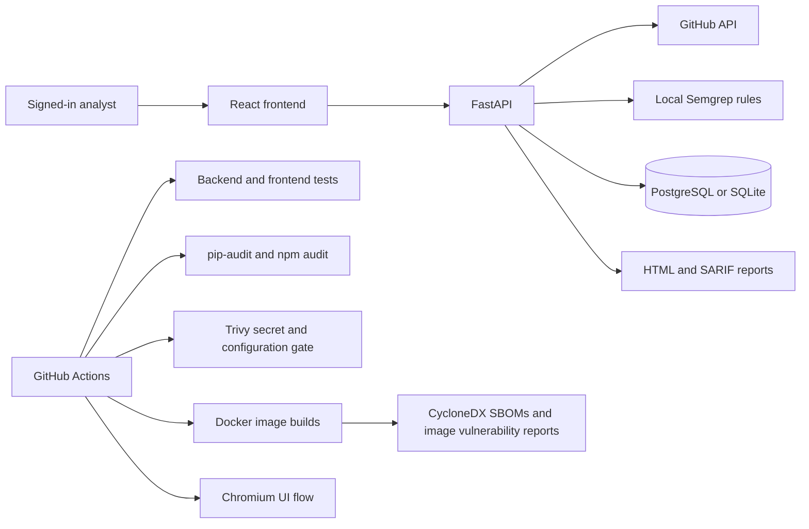

# Zorix project scope and portfolio evidence

Zorix is a security engineering project centered on **reproducible static analysis evidence**. It does not claim to be a penetration testing platform, SIEM, or compliance certification system.

## Current architecture

Both scan modes resolve the default branch to a commit SHA. Repository scans get the Git tree and fetch selected blobs by SHA; individual file scans fetch with the commit SHA as the GitHub API `ref`. Repository scans fail on truncated trees or limit violations. Semgrep scans the fetched files. Results, reviews, comparisons, and reports require the scan owner's token. Source contents and per-scan GitHub tokens are not stored in scan records.

## Evidence by role

| Role | Demonstrable work in this repository | Current limit |
| --- | --- | --- |
| Application security | Semgrep rules, finding evidence, manual review status, rescan comparison, SARIF export | Findings are unverified; no dynamic validation |
| DevSecOps | GitHub Actions tests and builds, browser flow, dependency audits, Trivy secret and configuration gate | No release deployment or production policy gate |
| Container security | Non-root images, loopback-bound ports, SBOMs, full image vulnerability reports, gate on fixable high/critical image findings | Unfixed upstream findings remain; no Kubernetes deployment |
| Security operations | Owner-scoped scan history and reports | No SIEM integration, alerting, or incident workflow |
| Penetration testing | Safe target validation and documented verification boundaries | No exploit execution or DAST |
| GRC and audit | Commit and blob identifiers, stored scan evidence, append-only review events protected by database triggers, schema migrations | No compliance mapping or external tamper-proof archival |

## Reproduce the evidence

Run `python -m pytest -q tests`, `npm test`, and `npm run build` using the setup in the root README. CI also runs `pip-audit`, `npm audit`, Trivy, and Docker builds. A local Docker smoke test should register a user, scan an authorized GitHub file, and download its HTML report. The API reports scanner failures explicitly; a failed scan must never be presented as a clean result.

## Remaining engineering work

1. Add dependency and container vulnerability findings to the application evidence model, with package coordinates, advisory IDs, and fixed versions.
2. Add operational retention controls and external audit archival.
3. Add a bounded background job queue for repository scans and a deployment guide with secret management.
4. Add opt-in dynamic testing for explicitly allowlisted local or staging targets, with proof of authorization and isolation.
5. Add application-level policy gates and SIEM export once their output is tested and documented.

Scanner dependency advisories and their current handling are listed in [SECURITY.md](../SECURITY.md). Claims on a resume or in a demo should match the tested capabilities above.
